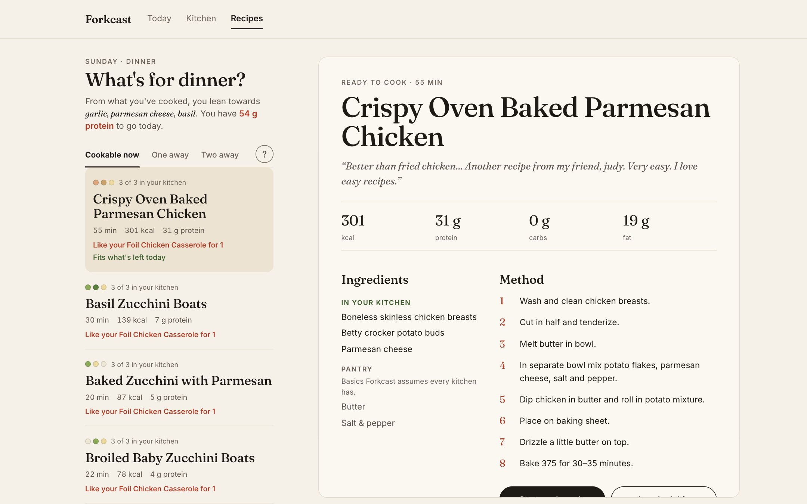
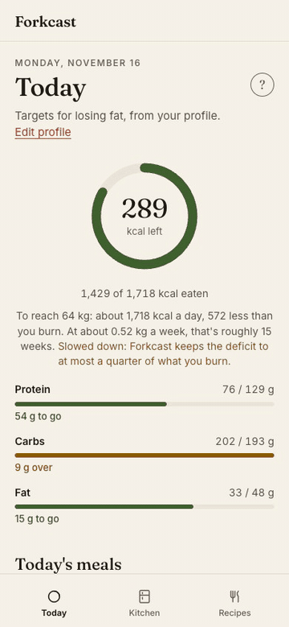
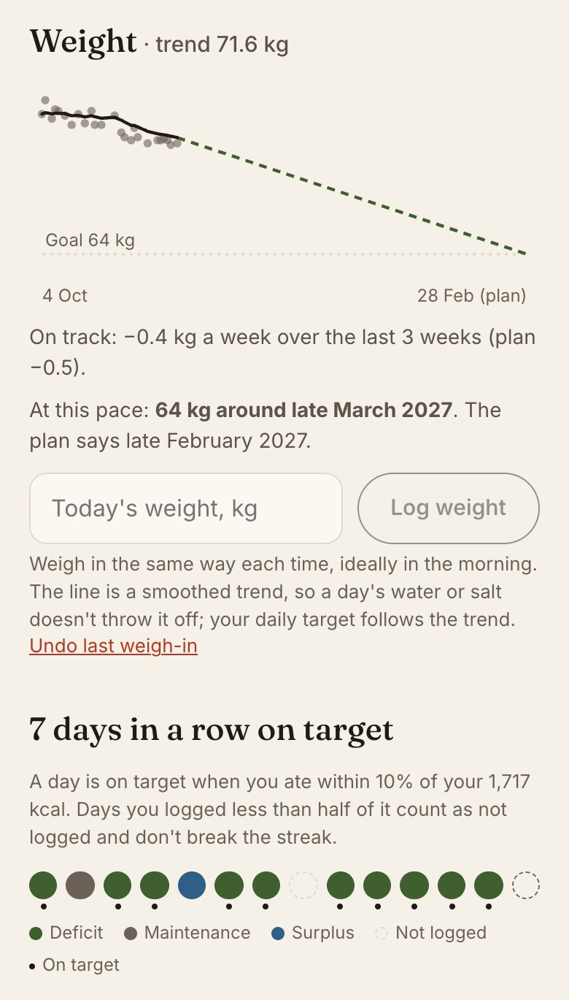
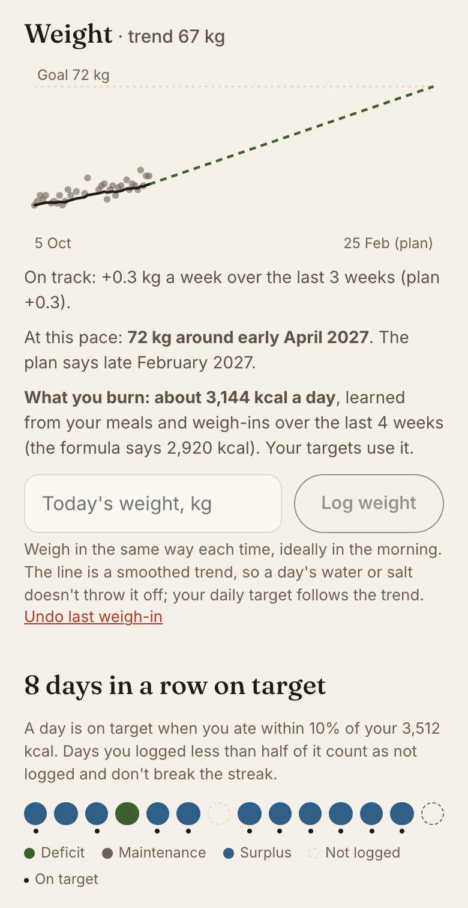
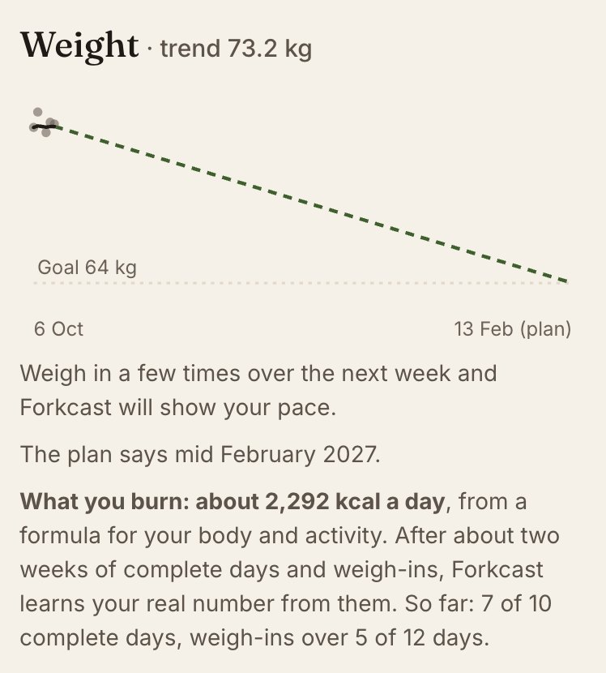
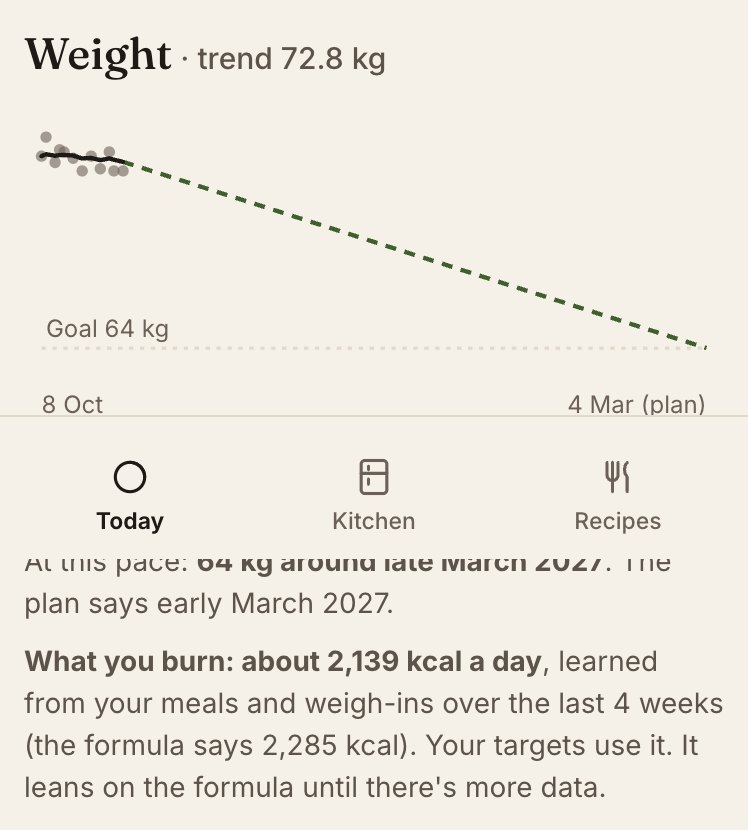
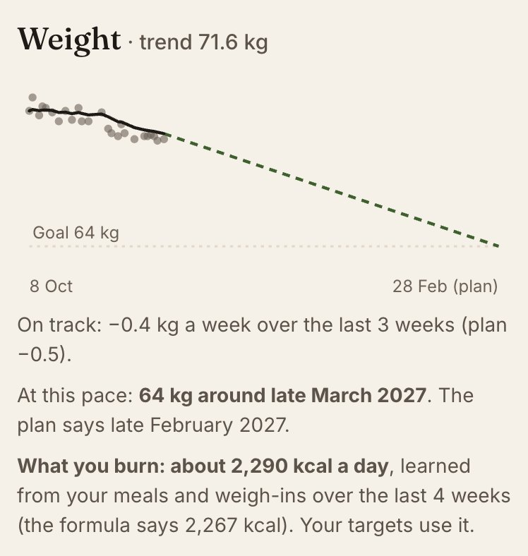
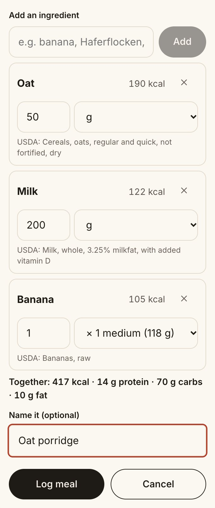

# Forkcast 🍴

**What should I cook next?** Forkcast is a kitchen app. It knows what food you
have, finds which of 87,861 recipes you can cook with it right now, puts the
ones that suit your taste and today's calorie and protein budget first, and
tells you what to buy to unlock more.

**At a glance**

- **Live, with testers.** The [demo](https://rockyyyy2397-forkcast.hf.space)
  has been online since November 2026. Clearer scan messages and meals built
  from ingredients came straight from a tester's requests.
- **Measured, not assumed.** Eight tests on data from outside the app. Listed
  recipes you can really cook: 65% → 92%. Suggested swaps a cook would use:
  33% → 95%. A typed German food within 10% of the calories on its pack:
  64% → 76%. [How the tests work](#evaluation)
- **Decisions in writing.** 71 product decisions, each with the options turned
  down and why ([APP_DECISIONS.md](APP_DECISIONS.md)).
- **Built to ship.** 514 tests and a browser test of a first visit on every
  change, a check of the live demo after every deploy, and no serious
  accessibility problems on any screen.
- **Built with AI.** Claude Code wrote most of the code; the product calls
  were mine ([how it was built](#how-this-was-built)).

**[Try the demo](https://rockyyyy2397-forkcast.hf.space)**: you get your own
copy of a demo kitchen (25 ingredients and two dishes cooked earlier in the
week), set up your own profile and start with an empty day. It is private to
you and saved for your browser, so it is still there when you come back. It is deleted 30 days after your last visit,
or at once with "Delete my data". Photo and label scanning work there too, up
to 10 scans a day. After two days without visitors the server sleeps, and the
next visit takes about a minute while it wakes up. Usage is counted only as
[anonymous totals](https://rockyyyy2397-forkcast.hf.space/stats).

<p align="center"></p>



| Recipes | Recipe | Worth buying | Today | Kitchen |
|---|---|---|---|---|
|  |  |  |  |  |
| What you can cook, best first | What you have is ticked | Three buys that unlock the most | Calories and macros left | What Forkcast matches against |

### Goals and progress

<p align="center"></p>

| Losing weight | Gaining weight |
|---|---|
|  |  |
| Deficit days on target, weight falling about 0.4 kg a week | Surplus days on target, weight rising about 0.25 kg a week |

Screenshots come from a demo kitchen with a sample profile, not real data. The
two people above are made up too: six weeks of generated weigh-ins and days
(`backend/app/sample.py`, fixed seed, D43), used only for these images.

## How it works

Everything rests on one step: turning messy food words into a fixed list of
1,790 ingredients. "2 cups chopped fresh basil", "Organic Basil" and "basil
leaves" all have to become `basil`, both for what is in your kitchen and for
every line of every recipe. Once both sides use the same list, the rest is
comparison.

1. **Your kitchen.** You type items (in English or German), photograph your open fridge or
   your shopping, or scan a barcode. A photo goes to a small vision model
   (Claude Haiku 5.5), which returns a list you check before anything is
   saved: what it is sure of is ticked, what it isn't is offered, and food in
   your kitchen that the photo didn't show is offered for removal (D69). A barcode is looked up in Open
   Food Facts, with a photo of the nutrition label as the fallback; a product
   Open Food Facts doesn't have is remembered under its barcode once its label
   has been read. Every item is then matched to the ingredient list.
2. **The recipes.** The 87,861 food.com recipes were matched to the same list
   once, ahead of time. A recipe with a line that can't be matched is left out
   of the suggestions, because the app couldn't tell whether you have it.
3. **Cookable now.** A recipe is cookable when every ingredient is in your
   kitchen. Basics (salt, pepper, water, oil, butter, flour, sugar) are assumed
   to be in every kitchen. Recipes missing one or two things get their own
   tabs.
4. **Order.** Among recipes missing equally few things, the ones that match
   your taste and fit what's left of today's budget come first.
5. **Swaps.** When a recipe misses one ingredient, the app may suggest
   something you have instead: "needs lime, try lemon".
6. **What to buy.** It picks the few items that would unlock the most new
   recipes: "yeast unlocks 196 recipes, then bread 131 more".
7. **Cooking and eating.** On a recipe, "Don't have it" and "Have it" fix the
   kitchen where a wrong guess shows. "I'm cooking this" pins the recipe;
   "I ate it" logs it and takes what ran out off the kitchen. Recipes give no
   amounts, so fresh meat, fish and greens start ticked as run out and the
   rest as some left, one tap each to change, with Undo (D70).
8. **A shopping list.** What ran out, what a recipe is missing and the "worth
   buying" picks go on it in one tap; ticking what you bought moves it into
   the kitchen (D71).

### The ingredient map

Taste and swaps use the [Epicure ingredient embeddings](https://arxiv.org/abs/2605.22391)
(Radzikowski & Chen, KAIKAKU.AI). Think of them as a map on which each of the
1,790 ingredients has a position, learned from a large collection of recipes:
ingredients that show up in similar recipes sit close together. (Technically,
300-dimensional vectors. One map is built from which ingredients appear
together, another from shared flavour compounds.) Epicure only provides the
map. Recipes, matching and all the app logic are built here.

- **Taste.** Every dish has a position on the map: the average of its
  ingredients, with rare ones counting more (saffron says more about a dish
  than onion). A recipe ranks higher the closer it is to the three dishes
  you've cooked that it most resembles; dishes you marked "Not for me" don't
  count. The feed names the closest one ("Like your Cherry Tomato Pasta") so
  you can see why. It works from the first logged meal and needs no training.
  Test 3 below shows what it can and can't do: it knows your *kind* of food,
  not which dishes you'll love.
- **Swaps.** A swap must come from the same food family (two herbs, two
  melting cheeses, two vinegars: 47 families written by hand) and be used in
  similar recipes according to the map. Being close on the map is not enough
  on its own: coconut and banana are neighbours because they are cooked
  *together*, not because one replaces the other. The evaluation below found
  exactly that.

### Calories and macros

Daily targets come from a standard formula (Mifflin-St Jeor) using your body,
activity level and goal (lose, keep or gain weight). Or set a goal weight and a
pace: Forkcast works out how much less or more than you burn to eat, and
roughly how long it takes, within safety limits (no goal below a healthy
weight, a calorie floor, a cap on the deficit). The pace is a share of your
weight, not fixed kilos: losing 0.75% a week is 0.6 kg at 80 kg but 0.45 kg
at 60, and it slows as you get closer, which the timeline allows for.

Today also keeps score: a streak of days on target, the last two weeks as
dots for deficit, maintenance and surplus days, and a weekly recap of meals
cooked and new recipes tried. Forgotten days don't count as a deficit, and
eating under your minimum never counts towards the streak. You can confirm a
day as complete ("Done for today?"), and the week's average deficit or surplus
is shown next to the plan's.

Log your weight now and then and Forkcast draws a smoothed trend, compares
your actual pace over the last three weeks with the plan, and tells you when
you'd reach your goal at that pace. Your daily target follows the trend.

The formula's idea of what you burn is often 10% or more off for one person:
a few hundred kcal a day, about the size of a whole deficit. So after about
two weeks of complete days and weigh-ins, Forkcast learns your real number:
if you ate 2,000 kcal a day and your weight stayed level, you burn about
2,000. The more data, the more it trusts yours over the formula; it never
moves more than 15% from it, and the Weight card says which number it uses.

**By the way, the plan redraws itself.** Here is the same made-up person at
weeks 1, 3 and 6 of the same six weeks:

| Week 1 | Week 3 | Week 6 |
|:-:|:-:|:-:|
|  |  |  |
| Too little data to learn from: the formula's 2,292 kcal, goal in mid February. | The first estimate from her own meals and weigh-ins is lower, 2,139 kcal. Her daily target drops from 1,719 to 1,604 kcal and the goal moves to early March. | More data, a steadier estimate: 2,290 kcal. The goal moves back to late February. |

Each weigh-in redraws the dashed line from where her trend is now. The low estimate in week 3 is what a few noisy
weeks look like, and why the estimate leans on the formula until there's more
data. She is made up (see [the note above](#goals-and-progress)), so these
cards show *how* the plan adapts. Test 6 below measures how close the learned
number gets to the truth.

Each recipe gets a score
from 0 to 1 for how well its mix of protein, carbs and fat matches what is
still missing today. When you are short on protein, high-protein dishes move up.

### Logging what you eat

A meal gets into Today in one of three ways: cook a recipe and tap "I cooked
this", scan a product's barcode or nutrition label, or build it from
ingredients. For a smoothie or a homemade sauce you add each ingredient and
how much of it ("Haferflocken, 50 g", "banana, 1 medium") and Forkcast adds
up the calories and macros.

<p align="center"></p>

The values per ingredient come from the USDA's food tables (FoodData
Central), converted to EU labelling (carbs without fibre, as on a European
pack; test 7) and matched to Forkcast's ingredient list: 740 of the 1,790
ingredients have values. The 300 used most in recipes, 96% of all ingredient mentions,
were checked by hand, and the first automatic match was wrong for 134 of them
(flour had become soy flour, egg the yolk). Checking 80 of the remaining
matches found 67 right (84%), so the app shows which USDA food it used and
marks the ones matched by name only. Rice, pasta, beans and other grains can
be weighed dry or cooked: 150 g of rice is about 530 kcal dry and 190 cooked.
A scanned product joins the same list with its own values, so skyr from a
pack and a banana make one meal; that also covers foods the USDA table
lacks, like quark and oat milk. When Open Food Facts knows a product's
serving, it starts at one serving (a 30 g scoop of protein powder, not 100 g).
Once you've logged a food, it starts at what you had last time instead:
your own amount beats any assumption.

Rating a meal teaches the recipe feed what you like, so a rating needs a
dish: a cooked recipe, or a meal built from two or more ingredients ("Like
your oat porridge"). A single food, a meal typed in as numbers, or one whose
foods recipes don't use (skyr, protein powder) can't be rated, and each says
why.

Meals you typed or built in the last month wait under "Log again", one tap
each, and a starred one stays at the top: most people eat the same few
breakfasts and snacks.

Logs can be fixed: a meal can be edited, a removed one comes back with Undo,
a cooked recipe can count as half a serving or two, and "‹ Earlier" goes back
to a day you forgot to fill in. Everyday words people type find the food they
mean: "Paprika" is the vegetable in a meal, "Reis gekocht" starts cooked, and
foods the USDA table lacks (quark, skyr, oat drink, muesli) use the median of
12 German packs on Open Food Facts, which the app names as the source.

One line can hold a whole meal: "2 Eier, Haferflocken 50 g, Kaffee mit Milch"
adds each food with its amount, and "1 TL Zucker" or "2 EL Olivenöl" are
spoons. A double tap on a slow connection still logs a meal once, and when the
server can't be reached the app says so rather than showing an empty kitchen. A cappuccino, a Döner, a Käsebrot or a Schnitzel
adds the foods of a typical serving, each with its own values, and the app
says it's a typical one so the part that differs can be changed. Milk and
yogurt come in the fat levels German shelves have (1.5% milk is 47 kcal,
whole 61; Greek yogurt about 10%), switchable on each row, and chickpeas and
beans can come from a can, drained, with the values of German cans.

## Evaluation

The app makes promises you act on. Seven are tested: six on data from outside
the app, one on simulated people. Every fix is judged on cases it wasn't
designed on:

1. **"You can cook this now."** Is a listed recipe really cookable from your
   kitchen?
2. **"Try this instead."** Would a cook actually use the suggested swap?
3. **"Suits your taste."** Does the taste ranking know what a real person
   likes? (Your kind of food, yes; your favourites, no. See test 3.)
4. **"This is what's in your photo."** Does photo scanning name your groceries?
5. **"These are the label's macros."** Does it read a nutrition label right?
6. **"This is what you burn."** Does learning from your meals and weigh-ins
   beat the formula?
7. **"Haferflocken, 50 g: 181 kcal."** Do the values for a food you type match
   the label on the pack you bought?

| Test | Before | After the fix | Judged on |
|---|---|---|---|
| 1. Listed recipes really cookable | 65% | **92%** | 3 new kitchens |
| 2. Suggested swaps that work | 33% | **95%** | new cases |
| 3. Picks what people cook next (50 = coin flip) | 55 | **61** | 2,710 real food.com users |
| 4. Photo scan proposes the right ingredient | 71% | **94%** | 289 unseen store photos |
| 5. Label read with the right calories | 78% | **83%** | 150 fresh products |
| 6. What you burn, off by (kcal a day, median) | 186 | **74** | 2,000 simulated people, 4 weeks |
| 7. Typed food's calories within 10% of its label | 64% | **76%** | 33 held-out German products |
| 8. Fridge photo: items found | 50% | **77%** | 51 photos of one staged fridge |

**Test 4, photo scanning,** on phone photos from a public grocery dataset. A
third of the misses were the ingredient matcher, not the camera: "orange
juice" became *orange* and "yoghurt" nothing. After that fix (D35): 76%,
with vegetables 85%, fruit 76% and cartons 69%. Switching the model from
Claude Haiku 4.5 to Haiku 5.5 (D69) took it to 94% (cartons 92%) at a fifth
of the price. Photos of a whole fridge are Test 8
([details](eval/RESULTS-stage4.md)).

**Test 5, nutrition labels,** on products from Open Food Facts, with database
disagreements checked by eye. The reader got all four values right for about
two in three products; its mistakes were kilojoules taken for kcal, "1,2 g"
read as 12 and a value from the neighbouring row. Two fixes: the app warns
when the values don't add up (D36), and a new prompt has the reader write out
the table first (D37), which cut the average calorie error on fresh products
from 6.7 to 4.0 kcal per 100 g ([details](eval/RESULTS-stage5.md)).

**Test 6, what you burn,** on simulated people, because no public data has
weeks of food logs with a known true burn. Each one's real burn is up to 15%
off the formula; they log 85% of days and weigh in with realistic water
swings. After four weeks of honest logs the typical error falls from 186 to
74 kcal a day. When a log misses 10% of what was eaten, the learned number
reads low, but that is the number their plan needs: the plan's error falls
from 272 to 104. Not tested: real people, and the water lost in the first
weeks of a diet ([details](eval/RESULTS-stage6.md)).

**Test 7, typed foods,** on single-ingredient products sold in Germany, from
Open Food Facts: you type "Haferflocken", does the app's number match the
pack? Two things were wrong. The values came from US tables, which count
fibre as carbohydrate where EU labels don't (oats had 9 g too many carbs),
and German compound words like "Vollmilch" and "Weizenmehl" found nothing.
After converting every value to EU labelling and reading compounds whole
(D53), calories are within 10% for 76% of held-out products (64% before) and
carbs within 3 g for 76% (36%). On 12 more kinds fetched later, the carbs
held up (31% to 50% within 3 g) but calories didn't move: the calorie gain
came from words the app now finds, not from the new values. The misses left
were fat levels (one milk, one yogurt) and canned beans, which hold more water
than boiled ones. Both were added later (D63, D64): "fettarme Milch" is now
right for all four products, and with the median of German cans (D65) canned
chickpeas are within 10% for three of four, which takes held-out calories
within 10% to 85%. Those numbers are no longer unseen: the cans come from the
same source as the test ([details](eval/RESULTS-stage7.md)).

**Test 8, a photo of the whole fridge,** on a public set of photos of one
fridge filled at random with 30 kinds of food, every item labelled. The
scanner's old model, Claude Haiku 4.5, found half of what was in the photo.
Claude Haiku 5.5 found 77% at a fifth of the price, and Claude Sonnet 5.5 80%
for twenty times more. With Haiku 5.5, keeping only what it is at least 70%
sure of leaves about 3 fixes per scan, against typing 11 items, so the scan
now uses Haiku 5.5 with that line (D69). Two answers first
marked wrong were right: the "butter" is margarine and some "milk" is soy
milk, as crops of the photos showed; both scores are reported. A lived-in
fridge is harder than this staged one ([details](eval/RESULTS-stage8.md)).

### How the tests work

Tests 1 and 2 work like marking an exam.

- **Real examples from outside the app:** ingredient lines from the recipes,
  grocery product names from the Instacart shopping dataset, and test kitchens
  written as plain shopping lists ("chicken thighs, rice, limes, …").
- **The answer key comes first.** Each example gets its correct answer by
  hand, following written rules, *before* the app's answer is looked at, so the
  key can't drift toward what the app does.
- **Then the app answers, and the two are compared.**
- **Some examples are kept aside.** When a test found a problem, the fix was
  built while looking at one part of the examples only. The result that counts
  is measured on examples nobody looked at while fixing (the "unseen" or
  held-out set), the way you test a student on new questions, not the ones
  they practised.

### Test 1: can you really cook what it lists?

Ten test kitchens were run through the app. For each, the top 20 "cookable
now" recipes were checked against the recipe's original wording. The test
found two rounds of problems, and each fix was judged on kitchens and
ingredient lines set aside *before* that fix was written.

| | before | after |
|---|---|---|
| **Fix 1: listed recipes that are really cookable** (unseen kitchen) | 13 of 20 (65%) | **16 of 20 (80%)** |
| Fix 1: ingredient lines matched to the wrong food (150 unseen lines) | 17% | 14% |
| **Fix 2: listed recipes that are really cookable** (3 new kitchens) | 53 of 60 (88%) | **55 of 60 (92%)** |
| Fix 2: ingredient lines matched to the wrong food (150 new lines) | 7.3% | 5.3% |

**Where it stands:** about **9 in 10** listed recipes are really cookable
(55 of 60 in kitchens no fix was designed on). Two other ways of counting agree.
In the four kitchens fix 2 *was* designed with, it went from 81% to 94%; in
the three development kitchens, from 93% to 98%. Those flatter the fix, so the
headline uses the fresh kitchens.

**Why it was wrong, round 1:** 22 of the first 23 false "cookable" recipes
had one cause. When the ingredient list had no entry for a product, the app
matched the food word inside it: "chicken stock" became chicken, "tomato
paste" became tomato, and "powdered sugar" became sugar, which every kitchen
is assumed to have. A kitchen with chicken therefore looked ready for every
recipe that needs chicken stock.

**The fix (D27):** a product now matches its own entry ("basil pesto" becomes
pesto) or nothing, and a recipe with an unmatched line stays out of the list.
That is the safer mistake. A missing recipe costs nothing; a recipe you can't
make costs a dinner. About 12,000 of 64,000 recipes leave the pool because of
it.

**Round 2, the same mistake for other words:** "tomato juice" still counted as
tomatoes, "chicken sausage" as chicken, "creamed corn" as corn, and "sweet
green pepper" as black pepper, a pantry staple. **The second fix (D29)** adds
those product words (juice from anything but citrus, syrup, sausage, cookie,
bread, pickle and more), stops on products like potato chips or Rice-a-Roni,
and reads sweet peppers as bell peppers. It also stops being too eager: a
chorizo sausage stays chorizo, and lemon juice is still lemon.

**Still wrong:** roughly one listed recipe in ten. The ingredient list has one
entry for coriander, so it can't tell fresh cilantro from ground coriander
seed; "dried beef" counts as beef; a bare "red pepper" is read as chili flakes
even when the recipe means a bell pepper; and "peas and carrots" is satisfied
by carrots alone.

### Test 2: are the swaps any good?

210 cases from seven test kitchens, each a recipe missing exactly one
ingredient, with the kitchen's other items as possible swaps. The usable swaps
were marked by hand before the app ran.

| 60 unseen cases (two new kitchens) | before fix | after fix |
|---|---|---|
| **Suggested swaps that work** | 18 of 54 (33%) | **20 of 21 (95%)** |
| Cases with a bad suggestion | 60% | 2% |
| Cases with a usable swap on hand that got one | 53% | 59% |

**Why it was wrong:** there were only eight food families (herbs, citrus, meat
and five more). For everything else the app trusted the ingredient map alone,
and the map puts things close that are *cooked together*, not things that
*replace* each other. So it offered bell pepper for chicken broth and oats for
baking powder.

**The fix:** 47 food families, and no suggestion at all outside them. The app
now suggests a swap in about a third of cases instead of nine in ten, but
those suggestions almost always work. It even finds a usable swap more often
than before, because the old version often picked a wrong item when a right
one was on hand.

### Test 3: does it know what you like?

No hand-made answer key here: real people's ratings are the key. 2,710
food.com users, chosen and frozen before the app scored anyone, were replayed
through the app. The earliest 70% of each person's ratings became their
cooking history (5 stars = liked, 3 or fewer = "Not for me"), and the app's
own taste code ranked recipes. Then two questions about the 30% it never saw,
each scored as "out of 100 pairs, how many in the right order" (50 is a coin
flip):

| | First version | **Now (nearest dishes)** | Most popular | Other people's stars |
|---|---|---|---|---|
| **What they cook next**, against 100 random recipes | 55 | **61** | 78 | 49 |
| **Which they'll love**: 5-star picks above 3-star-or-lower ones | 48 | **52** | 59 | 63 |

**Why the first version failed:** it averaged everything you cooked into one
point. Someone who cooks curries and cakes ends up halfway between, close to
neither. And on the ingredient map every dish looks a lot like every other
one (they all share the common ingredients), so "close to your average" said
almost nothing.

**The fix (D31):** compare each recipe with your *nearest* dishes instead of
your average, let rare ingredients count more, and subtract what all dishes
have in common. It was chosen among about 20 variants on a separate group of 2,709
users and then judged once on the 2,710 above. Taste now beats a coin flip for
81% of people on the first question, up from 63%. The feed's "92% like what
you cook" looked like a likelihood and wasn't one, so it became "Like your
Cherry Tomato Pasta", shown only when the match is close.

**What it still can't do:** pick favourites. 52 is barely above a coin flip,
and its range (50 to 54) includes one. Two chicken curries share almost every
ingredient even when one is great and one is bland: ingredients can't see
quality, other people's stars can. And popularity still beats taste at
guessing what someone will cook. Using other people's ratings would be the
next step; it means shipping rating data with the recipes, so it needs a
licence check first.

**How sure:** thousands of people, so the gaps are firm (each score is within
about a point, "which they'll love" within about two). A food.com rating is
not a logged meal, and 72% of all ratings are 5 stars, which makes favourites
hard for any method. Details:
[`eval/RESULTS-stage3.md`](eval/RESULTS-stage3.md).

### How much to trust these numbers

- **Two markers, checked against each other.** Test 1's answer keys were
  written twice, independently: once by Claude Opus 5.5, which built the eval,
  and once by a different model, GPT-6 Astra, that saw only the questions and
  the rules, never the other answers or the app. Across all rounds they gave
  compatible answers for 94% of ingredient lines (538 of 575) and the same
  verdict for 93% of recipes (213 of 230). Where they disagreed, a human made
  the call, usually by settling a rule, and the rules record each decision.
  Two of them move the numbers most. A recipe asking for garlic powder counts
  as cookable if you have fresh garlic; decided the other way, the first
  unseen kitchen would score 70% instead of 80%. Fresh cilantro does *not*
  count as ground coriander, which costs the app three recipes in the newest
  kitchens. Test 2's keys have one marker so far (10 cases flagged unsure).
- **Small samples in tests 1 and 2.** "55 of 60" means the true share is likely between about
  82% and 96%. Each fix moved only a few recipes, so read the before/after
  pairs as "clearly better", not as exact gains. Test 3 is the opposite:
  thousands of people, so its gaps are firm.
- **Everything is public:** every example, answer key, script and remaining
  error is in [`eval/`](eval/), with the full write-ups in
  [`eval/RESULTS.md`](eval/RESULTS.md) (test 1),
  [`eval/RESULTS-stage2.md`](eval/RESULTS-stage2.md) (test 2) and
  [`eval/RESULTS-stage3.md`](eval/RESULTS-stage3.md) (test 3).

## Numbers

- **Vocabulary coverage** (prototype, `prototype/recipe_coverage.py`, n = 1,228
  food.com recipes): 94.9% of ingredient mentions map to Epicure's 1,790
  ingredients, and 95.1% of recipes match at ≥ 80%. That result picked the
  recipe source (decision D1).
- **Corpus:** 87,861 recipes and ~794k ingredient rows, with per-serving
  nutrition.
- **Vision cost:** about $0.005 per Haiku scan. Barcode lookups cost nothing.
- **Tests:** 514 pytest tests in about three seconds, offline and without the
  corpus, frontend lint and build, and a browser smoke test of a first visit,
  all in CI. 55 of the pytest tests need the Epicure weights; CI caches them and
  fails rather than skip those tests.

## Design

The look is warm and editorial: a serif for headings, a cream background and
food colours used sparingly, so recipes read like a cookbook page rather than a
dashboard. It is built phone-first and switches to a two-column layout on a
laptop, with the open recipe beside the list.

The app should explain itself. A first visit says what you get, then how it
works, then asks for the profile and shows your day in numbers; the demo offers
a sample person for anyone just looking around. Each main screen has a **?** button that explains what you are looking at
in plain words (for example what the coloured dots and "Like your …"
mean). Labels say what they mean instead of using internal terms.

It follows the system's light or dark mode, every text colour passes the WCAG
AA contrast check, and there is a keyboard-friendly focus style and reduced
motion support. `ops/screenshots.sh` rebuilds the app, starts it on a throwaway
demo kitchen, records the walkthrough and takes the screenshots above in a real
browser, and runs the
[axe-core](https://github.com/dequelabs/axe-core) accessibility check on every
screen. It fails if axe finds a serious or critical WCAG 2.1 AA problem; the
current screens have none.

## Design decisions

Every non-obvious choice is logged with its alternatives and why they were
rejected: 71 decisions in [`APP_DECISIONS.md`](APP_DECISIONS.md).
[`EPICURE_PAPER_NOTES.md`](EPICURE_PAPER_NOTES.md) covers what the embeddings
can and cannot do. A few that shaped the app:

- **No trained recommender (D6).** With one user there is nobody else's
  behaviour to learn from, so taste is the average of what you cooked:
  explainable, and works from the first meal. Test 3 showed the single
  average barely beat a coin flip; D31 compares with your nearest dishes
  instead, which helps with your kind of food but not with favourites.
- **Wrong is worse than missing (D27, D28, D29).** Both fixes above trade coverage
  for trust: fewer recipes and fewer swaps, but ones you can rely on.
- **Confirm before commit (D8).** Vision miscounts are expected, so the cheap
  model plus a mandatory checklist beats an expensive model trusted blindly.
- **Shared password, not accounts (D15).** Real multi-user means a `user_id`
  migration across every table. Deferred until someone needs their own kitchen.

## How this was built

I built Forkcast with Claude Code, Anthropic's coding agent, which wrote most
of the code; the commits it co-wrote carry its name. My part was the product:
deciding what to build next and what to leave out, testing it with people and
turning their feedback into changes, choosing what each test measures and what
counts as good enough, and approving every change before it went live. The
decision log is the record of those calls.

## Stack

FastAPI · SQLite · numpy · Epicure embeddings (Hugging Face) · Claude Haiku
(vision, structured outputs) · Open Food Facts · USDA FoodData Central · React + TypeScript + Vite PWA ·
Docker · GitHub Actions

## Running it

```bash
pip install -r requirements.txt
cd frontend && npm ci && npm run build && cd ..

# Recipe corpus (~130 MB, read-only), published separately:
mkdir -p data && curl -L -o data/corpus.db \
  https://github.com/rocky2397/forkcast-corpus/releases/download/corpus-20261115-d35/corpus.db

export FORKCAST_DATA_DIR=$PWD/data FORKCAST_CORPUS_DB=$PWD/data/corpus.db
export ANTHROPIC_API_KEY=...   # only needed for photo and label scanning
uvicorn app.main:app --app-dir backend --port 8000
```

Then open http://localhost:8000. The Epicure weights (~6 MB) download from
Hugging Face on first start. `dev.sh` and `ops/` are the author's own setup,
which keeps everything on an external drive (D10, D11). Their paths are
machine-specific. [`DEPLOY.md`](DEPLOY.md) covers the Docker image and optional hosting
behind a shared password.

## Tests

```bash
pip install -r requirements-dev.txt
pytest
```

The 55 tests that need the Epicure weights (swaps and taste ranking) skip
themselves locally unless the weights are cached. CI downloads and caches
them first and sets `FORKCAST_REQUIRE_EMBEDDINGS=1`, so there a missing
download fails the run instead of quietly skipping them. The suite runs with
`HF_HUB_OFFLINE=1`, so a test that would download anything fails loudly.

The browser smoke test checks that the screens and the API still fit
together, which neither side's unit tests can see:

```bash
ops/e2e.sh            # needs Google Chrome, the corpus and the Epicure weights
```

It starts the app on an empty data dir and makes a first visit in Chrome:
the welcome, a profile with a goal weight and the day it gives, the kitchen, the recipe feed, a cooked recipe
and what ran out, fixing the kitchen on a recipe, cooking and eating with Undo, the shopping list, a fridge scan (the model's
answer faked), a typed meal, a product that isn't on Open Food Facts (the
label reader faked, the rest real) added to a meal with a banana, a product that starts at one serving, a meal built from ingredients and logged again,
everyday words, a line with amounts and a dish, fat levels and a can, German
spoons and a typo, double taps, editing a meal, Undo, servings and an earlier
day, the calmer screens and recipe notes from the UX reviews, the back button,
a lost connection, "Done for today", a weigh-in and a reload.
It fails if a screen doesn't show what it should, on any JavaScript or
console error, on any API error, and on a serious accessibility problem
(axe-core) on any screen. Breaking the app on purpose (a renamed API field,
a value the API rejects, a crash in one card, a button without a name, text
too faint to read) makes it fail each time. CI runs it on every push, with
the same recipe corpus as the demo.

## Data and attribution

- **Epicure embeddings:** Jakub Radzikowski & Josef Chen (KAIKAKU.AI),
  [arXiv:2605.22391](https://arxiv.org/abs/2605.22391). Weights
  [`Kaikaku/epicure-*`](https://huggingface.co/Kaikaku/epicure-core) under
  CC BY 4.0.
- **Recipes:** food.com recipes from the Hugging Face mirror
  [`KingName1/food.com`](https://huggingface.co/datasets/KingName1/food.com),
  which matches the *Food.com Recipes and Interactions* dataset (Majumder et al.,
  EMNLP 2019). The mirror states no licence. Recipe text belongs to its food.com
  authors, and the derived corpus is shared for non-commercial, research and
  demo use only.
- **Ratings (test 3 only):** `RAW_recipes.csv` and `RAW_interactions.csv` from
  Kaggle's [*Food.com Recipes and User Interactions*](https://www.kaggle.com/datasets/shuyangli94/food-com-recipes-and-user-interactions)
  (Majumder et al., [EMNLP 2019](https://aclanthology.org/D19-1613/)). Not
  redistributed here; only food.com user ids for the frozen test split are.
- **Fridge photos (test 8, and the demo's sample fridge):** the
  [aicook dataset](https://universe.roboflow.com/karel-cornelis-q2qqg/aicook-lcv4d)
  by Karel Cornelis (Erasmus Brussels), MIT licence. One photo ships, resized,
  as `frontend/public/sample-fridge.jpg`; the others are not redistributed.
- **Packaged food:** [Open Food Facts](https://world.openfoodfacts.org), ODbL.
- **Ingredient nutrition:** U.S. Department of Agriculture, Agricultural
  Research Service, [FoodData Central](https://fdc.nal.usda.gov), SR Legacy
  (2018), public domain. `backend/app/ingredient_nutrition.json` is derived from it.

## License

Code: [MIT](LICENSE). The data above keeps its own terms.
