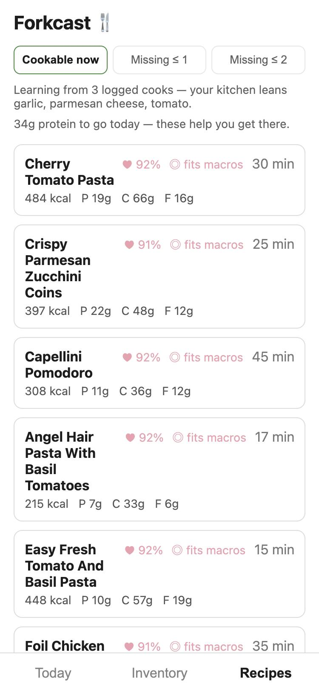

# Forkcast 🍴

**What should I cook next?** A food-inventory PWA that ranks 87,861 recipes by
what is actually in your kitchen, learns your taste from what you cook, and
steers suggestions toward the calories and macros you still have left today.

It is built on the [Epicure ingredient embeddings](https://arxiv.org/abs/2605.22391)
(Radzikowski & Chen, KAIKAKU.AI): 300-dimensional vectors over 1,790 canonical
ingredients, trained so that one space answers *"what goes with this?"*
(co-occurrence) and another answers *"what can replace this?"* (flavour chemistry).
Epicure stops at ingredients. Recipes, quantities, input normalization and goal
logic are built here.

| Today | Recipe feed | Recipe detail | Worth buying |
|---|---|---|---|
|  |  |  |  |
| Macros against Mifflin-St Jeor targets | Ranked by taste and by what fits today's remaining macros | Ingredients you have are ticked; lemon stands in for lime | Three purchases that unlock 434 more recipes |

> **The UI is a working first version, not a finished design.** It shows the
> engine behind it (ranking, substitutions, macro steering), and a visual polish
> pass is next. Screenshots come from a demo kitchen with a sample profile.

## What it does

| Feature | How it works |
|---|---|
| **Inventory from a photo** | Snap your groceries → `claude-haiku-4-5` with structured outputs returns a validated item list → you confirm on a checklist before anything is saved. Free text is normalized to Epicure's vocabulary with an alias table and fuzzy matching. |
| **Packaged food, barcode first** | In-browser barcode detection (native `BarcodeDetector`, self-hosted zxing WASM fallback for iOS) → Open Food Facts. Only when that fails does a photo of the German *Nährwerttabelle* go to Haiku. Each product is resolved once and cached. |
| **Cookable-now ranking** | Recipes sorted by how few ingredients you are missing, then by taste and macro fit. Staples (salt, oil, water…) never count as missing. |
| **Substitutions** | "Needs basil, try your oregano": a candidate must rank in the missing ingredient's top co-occurrence **and** top chemistry neighbours, and pass a coarse food-class check. Ranks, not raw cosines, because cosines are not comparable across hub and tail ingredients. |
| **Taste learning** | Your taste is a time-decayed (30-day half-life) centroid of the ingredient vectors in what you cooked, with likes boosted and dislikes subtracted. No training, works from the first logged meal, and explainable: the feed says which ingredients your kitchen leans towards. |
| **Macro-aware feed** | Targets from Mifflin-St Jeor × activity, adjusted for cut / maintain / bulk. Each recipe gets a 0–1 fit: the cosine between its calorie split and what is left of today's budget, decayed rather than cut off when it overshoots. |
| **Shopping suggestions** | Greedy set cover over the ~15k recipes you are 1–3 ingredients short of: "yeast unlocks 141 recipes, then milk +177 more", with counts that are marginal and never double-counted. |

## Numbers

- **Vocabulary coverage** (prototype, `prototype/recipe_coverage.py`, n = 1,228
  food.com recipes): 94.9% of ingredient mentions map to Epicure's 1,790
  ingredients, and 95.1% of recipes match at ≥ 80%. That result picked the
  recipe source (decision D1).
- **Corpus:** 87,861 recipes and ~794k ingredient rows after normalization, with
  per-serving nutrition.
- **Vision cost:** about $0.005 per Haiku scan. Barcode lookups cost nothing.
- **Tests:** 136 pytest tests in under a second, offline and without the corpus (24 of
  them need the Epicure weights and skip without them), plus frontend lint and
  build, all in CI.

## Evaluation

The question Forkcast has to get right first: **when it says a recipe is
"cookable now", can you actually cook it?** Everything else (taste ranking,
macros, the shopping list) builds on that list.

The eval lives in [`eval/`](eval/). Its data comes from outside the app's code:
ingredient strings sampled from the recipe corpus, and real grocery names from
the Instacart Market Basket dataset, weighted by how often they are bought.
Every string is labelled with its correct ingredient **without seeing the
matcher's answer**. Four test kitchens, written in plain words, are run through
the engine, and each listed recipe is judged from its original ingredient text.

| | before | after D27 |
|---|---|---|
| **"Cookable now" precision@20**, held-out kitchen | 13/20 = 65% | **16/20 = 80%** |
| "Cookable now" precision@20, design kitchens | 37/60 = 62% | 56/60 = 93% |
| **Wrong-match rate**, 150 held-out strings | 17.3% | **14.0%** |
| Wrong-match rate, held-out grocery names | 20.0% | 14.0% |
| Recipes in the cookable pool | 64,375 | 52,367 |

**What it found:** 22 of 23 false "cookable" recipes came from one error class.
When the vocabulary had no entry for a product, the matcher fell back to the
food word inside it:
- powdered sugar became the sugar staple, which is always "in stock";
- chicken stock became chicken;
- tomato paste became tomato.

The fix (D27) makes such a phrase match the product or nothing: `basil pesto`
becomes pesto, and `chicken stock` becomes no match. A missed match only drops
a recipe from the list, but a wrong one lists a recipe you can't make, so the
pool shrinks by about 12,000 recipes on purpose.

**How to read it:** the fix was designed on the development data. The
held-out strings and kitchen were sampled with a different seed and labelled
before the fixed matcher ran on them, so those are the honest numbers. With
n = 20, "65% → 80%" is a direction, not a precise gain. All labels are by
Claude, following written rules in
[`eval/data/LABELING.md`](eval/data/LABELING.md); 34 strings are flagged unsure
for human review. Remaining errors and the full method are in
[`eval/RESULTS.md`](eval/RESULTS.md).

## Design decisions

Every non-obvious choice is logged with its alternatives and why they were
rejected: 27 decisions in [`APP_DECISIONS.md`](APP_DECISIONS.md).
[`EPICURE_PAPER_NOTES.md`](EPICURE_PAPER_NOTES.md) covers what the embeddings
can and cannot do. A few that shaped the app:

- **No trained recommender (D6).** With one user there is no collaborative
  signal. An embedding centroid is honest about that and still ranks well.
- **Confirm before commit (D8).** Vision miscounts are expected, so the cheap
  model plus a mandatory checklist beats an expensive model trusted blindly.
- **Shared password, not accounts (D15).** Real multi-user means a `user_id`
  migration across every table. Deferred until someone needs their own kitchen.

## Stack

FastAPI · SQLite · numpy · Epicure embeddings (Hugging Face) · Claude Haiku
(vision, structured outputs) · Open Food Facts · React + TypeScript + Vite PWA ·
Docker · GitHub Actions

## Running it

```bash
pip install -r requirements.txt
cd frontend && npm ci && npm run build && cd ..

# Recipe corpus (~130 MB, read-only), published separately:
mkdir -p data && curl -L -o data/corpus.db \
  https://github.com/rocky2397/forkcast-corpus/releases/download/corpus-20261114-d27/corpus.db

export FORKCAST_DATA_DIR=$PWD/data FORKCAST_CORPUS_DB=$PWD/data/corpus.db
export ANTHROPIC_API_KEY=...   # only needed for photo and label scanning
uvicorn app.main:app --app-dir backend --port 8000
```

Then open http://localhost:8000. The Epicure weights (~6 MB) download from
Hugging Face on first start. `dev.sh` and `ops/` are the author's own setup,
which keeps everything on an external drive (D10, D11). Their paths are
machine-specific. [`DEPLOY.md`](DEPLOY.md) covers the Docker image and optional hosting
behind a shared password.

## Tests

```bash
pip install -r requirements-dev.txt
pytest
```

Tests that need the Epicure weights skip themselves unless the weights are
already cached. CI runs the suite with `HF_HUB_OFFLINE=1`, so a test that would
download anything fails loudly instead.

## Data and attribution

- **Epicure embeddings:** Jakub Radzikowski & Josef Chen (KAIKAKU.AI),
  [arXiv:2605.22391](https://arxiv.org/abs/2605.22391). Weights
  [`Kaikaku/epicure-*`](https://huggingface.co/Kaikaku/epicure-core) under
  CC BY 4.0.
- **Recipes:** food.com recipes from the Hugging Face mirror
  [`KingName1/food.com`](https://huggingface.co/datasets/KingName1/food.com),
  which matches the *Food.com Recipes and Interactions* dataset (Majumder et al.,
  EMNLP 2019). The mirror states no licence. Recipe text belongs to its food.com
  authors, and the derived corpus is shared for non-commercial, research and
  demo use only.
- **Packaged food:** [Open Food Facts](https://world.openfoodfacts.org), ODbL.

## License

Code: [MIT](LICENSE). The data above keeps its own terms.
