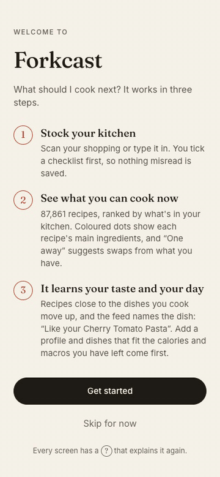
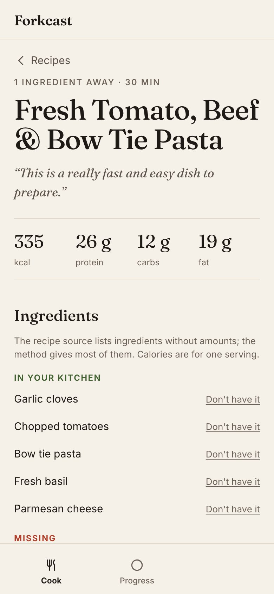
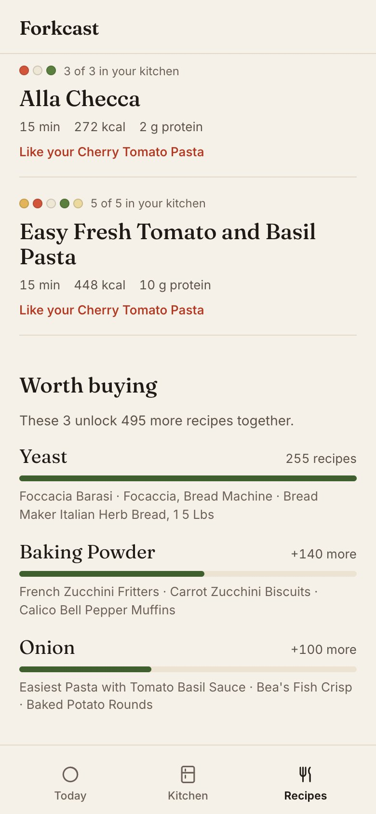
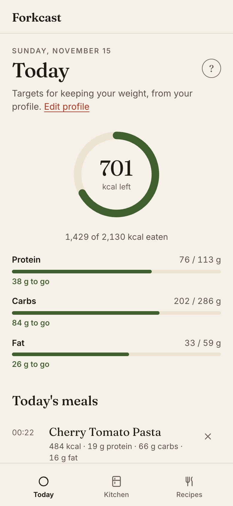
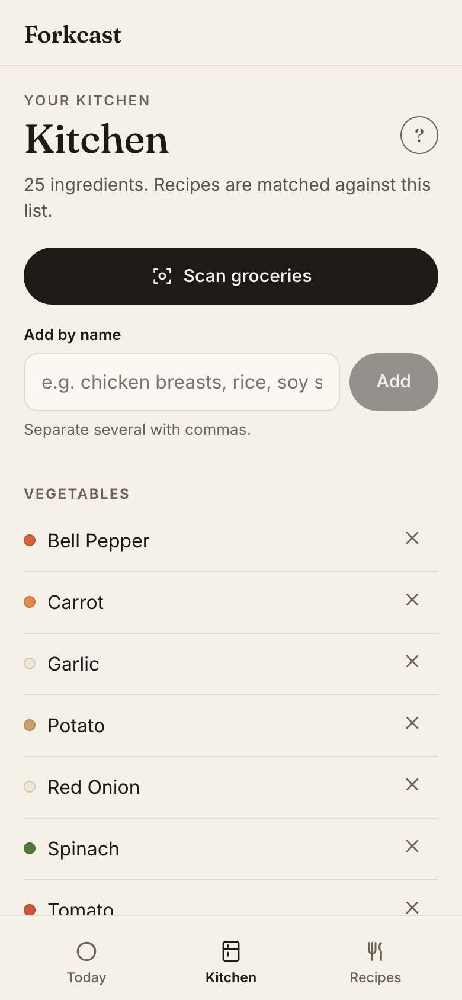

# Forkcast 🍴

**What should I cook next?** Forkcast is a kitchen app. It knows what food you
have, finds which of 87,861 recipes you can cook with it right now, puts the
ones that suit your taste and today's calorie and protein budget first, and
tells you what to buy to unlock more.

<p align="center"></p>


| Recipes | Recipe | Worth buying | Today | Kitchen |
|---|---|---|---|---|
|  |  |  |  |  |
| What you can cook, best first | What you have is ticked | Three buys that unlock the most | Calories and macros left | What Forkcast matches against |

Screenshots come from a demo kitchen with a sample profile, not real data.

## How it works

Everything rests on one step: turning messy food words into a fixed list of
1,790 ingredients. "2 cups chopped fresh basil", "Organic Basil" and "basil
leaves" all have to become `basil`, both for what is in your kitchen and for
every line of every recipe. Once both sides use the same list, the rest is
comparison.

1. **Your kitchen.** You type items, photograph your groceries or scan a
   barcode. A photo goes to a small vision model (Claude Haiku), which returns
   a list you confirm before anything is saved. A barcode is looked up in Open
   Food Facts, with a photo of the nutrition label as the fallback. Every item
   is then matched to the ingredient list.
2. **The recipes.** The 87,861 food.com recipes were matched to the same list
   once, ahead of time. A recipe with a line that can't be matched is left out
   of the suggestions, because the app couldn't tell whether you have it.
3. **Cookable now.** A recipe is cookable when every ingredient is in your
   kitchen. Basics (salt, pepper, water, oil, butter, flour, sugar) are assumed
   to be in every kitchen. Recipes missing one or two things get their own
   tabs.
4. **Order.** Among recipes missing equally few things, the ones that match
   your taste and fit what's left of today's budget come first.
5. **Swaps.** When a recipe misses one ingredient, the app may suggest
   something you have instead: "needs lime, try lemon".
6. **What to buy.** It picks the few items that would unlock the most new
   recipes: "yeast unlocks 196 recipes, then bread 131 more".

### The ingredient map

Taste and swaps use the [Epicure ingredient embeddings](https://arxiv.org/abs/2605.22391)
(Radzikowski & Chen, KAIKAKU.AI). Think of them as a map on which each of the
1,790 ingredients has a position, learned from a large collection of recipes:
ingredients that show up in similar recipes sit close together. (Technically,
300-dimensional vectors. One map is built from which ingredients appear
together, another from shared flavour compounds.) Epicure only provides the
map. Recipes, matching and all the app logic are built here.

- **Taste.** Every dish has a position on the map: the average of its
  ingredients. Your taste is the average position of what you cooked. Recent
  dishes and dishes you liked count more, and dishes you disliked push it
  away. Recipes close to that point rank higher. The feed says which
  ingredients your taste sits nearest to ("your kitchen leans garlic, parmesan,
  tomato"), so you can see why. It works from the first logged meal and needs
  no training.
- **Swaps.** A swap must come from the same food family (two herbs, two
  melting cheeses, two vinegars: 47 families written by hand) and be used in
  similar recipes according to the map. Being close on the map is not enough
  on its own: coconut and banana are neighbours because they are cooked
  *together*, not because one replaces the other. The evaluation below found
  exactly that.

### Calories and macros

Daily targets come from a standard formula (Mifflin-St Jeor) using your body,
activity level and goal (lose, keep or gain weight). Each recipe gets a score
from 0 to 1 for how well its mix of protein, carbs and fat matches what is
still missing today. When you are short on protein, high-protein dishes move up.

## Evaluation

The app makes promises you act on. Two are tested so far:

1. **"You can cook this now."** Is a listed recipe really cookable from your
   kitchen?
2. **"Try this instead."** Would a cook actually use the suggested swap?

**Not tested yet:** whether the taste ranking matches what people like, and
photo scanning. Taste needs real people's ratings linked to the recipes. The
food.com ratings are public, but the table that links them to recipes sits
behind a Kaggle sign-in, so that test is parked.

### How the tests work

Both tests work like marking an exam.

- **Real examples from outside the app:** ingredient lines from the recipes,
  grocery product names from the Instacart shopping dataset, and test kitchens
  written as plain shopping lists ("chicken thighs, rice, limes, …").
- **The answer key comes first.** Each example gets its correct answer by
  hand, following written rules, *before* the app's answer is looked at, so the
  key can't drift toward what the app does.
- **Then the app answers, and the two are compared.**
- **Some examples are kept aside.** When a test found a problem, the fix was
  built while looking at one part of the examples only. The result that counts
  is measured on examples nobody looked at while fixing (the "unseen" or
  held-out set), the way you test a student on new questions, not the ones
  they practised.

### Test 1: can you really cook what it lists?

Ten test kitchens were run through the app. For each, the top 20 "cookable
now" recipes were checked against the recipe's original wording. The test
found two rounds of problems, and each fix was judged on kitchens and
ingredient lines set aside *before* that fix was written.

| | before | after |
|---|---|---|
| **Fix 1: listed recipes that are really cookable** (unseen kitchen) | 13 of 20 (65%) | **16 of 20 (80%)** |
| Fix 1: ingredient lines matched to the wrong food (150 unseen lines) | 17% | 14% |
| **Fix 2: listed recipes that are really cookable** (3 new kitchens) | 53 of 60 (88%) | **55 of 60 (92%)** |
| Fix 2: ingredient lines matched to the wrong food (150 new lines) | 7.3% | 5.3% |

**Where it stands:** about **9 in 10** listed recipes are really cookable
(55 of 60 in kitchens no fix was designed on). Two other ways of counting agree.
In the four kitchens fix 2 *was* designed with, it went from 81% to 94%; in
the three development kitchens, from 93% to 98%. Those flatter the fix, so the
headline uses the fresh kitchens.

**Why it was wrong, round 1:** 22 of the first 23 false "cookable" recipes
had one cause. When the ingredient list had no entry for a product, the app
matched the food word inside it: "chicken stock" became chicken, "tomato
paste" became tomato, and "powdered sugar" became sugar, which every kitchen
is assumed to have. A kitchen with chicken therefore looked ready for every
recipe that needs chicken stock.

**The fix (D27):** a product now matches its own entry ("basil pesto" becomes
pesto) or nothing, and a recipe with an unmatched line stays out of the list.
That is the safer mistake. A missing recipe costs nothing; a recipe you can't
make costs a dinner. About 12,000 of 64,000 recipes leave the pool because of
it.

**Round 2, the same mistake for other words:** "tomato juice" still counted as
tomatoes, "chicken sausage" as chicken, "creamed corn" as corn, and "sweet
green pepper" as black pepper, a pantry staple. **The second fix (D29)** adds
those product words (juice from anything but citrus, syrup, sausage, cookie,
bread, pickle and more), stops on products like potato chips or Rice-a-Roni,
and reads sweet peppers as bell peppers. It also stops being too eager: a
chorizo sausage stays chorizo, and lemon juice is still lemon.

**Still wrong:** roughly one listed recipe in ten. The ingredient list has one
entry for coriander, so it can't tell fresh cilantro from ground coriander
seed; "dried beef" counts as beef; a bare "red pepper" is read as chili flakes
even when the recipe means a bell pepper; and "peas and carrots" is satisfied
by carrots alone.

### Test 2: are the swaps any good?

210 cases from seven test kitchens, each a recipe missing exactly one
ingredient, with the kitchen's other items as possible swaps. The usable swaps
were marked by hand before the app ran.

| 60 unseen cases (two new kitchens) | before fix | after fix |
|---|---|---|
| **Suggested swaps that work** | 18 of 54 (33%) | **20 of 21 (95%)** |
| Cases with a bad suggestion | 60% | 2% |
| Cases with a usable swap on hand that got one | 53% | 59% |

**Why it was wrong:** there were only eight food families (herbs, citrus, meat
and five more). For everything else the app trusted the ingredient map alone,
and the map puts things close that are *cooked together*, not things that
*replace* each other. So it offered bell pepper for chicken broth and oats for
baking powder.

**The fix:** 47 food families, and no suggestion at all outside them. The app
now suggests a swap in about a third of cases instead of nine in ten, but
those suggestions almost always work. It even finds a usable swap more often
than before, because the old version often picked a wrong item when a right
one was on hand.

### How much to trust these numbers

- **Two markers, checked against each other.** Test 1's answer keys were
  written twice, independently: once by Claude Opus 5.5, which built the eval,
  and once by a different model, GPT-6 Astra, that saw only the questions and
  the rules, never the other answers or the app. Across all rounds they gave
  compatible answers for 94% of ingredient lines (538 of 575) and the same
  verdict for 93% of recipes (213 of 230). Where they disagreed, a human made
  the call, usually by settling a rule, and the rules record each decision.
  Two of them move the numbers most. A recipe asking for garlic powder counts
  as cookable if you have fresh garlic; decided the other way, the first
  unseen kitchen would score 70% instead of 80%. Fresh cilantro does *not*
  count as ground coriander, which costs the app three recipes in the newest
  kitchens. Test 2's keys have one marker so far (10 cases flagged unsure).
- **Small samples.** "55 of 60" means the true share is likely between about
  82% and 96%. Each fix moved only a few recipes, so read the before/after
  pairs as "clearly better", not as exact gains.
- **Everything is public:** every example, answer key, script and remaining
  error is in [`eval/`](eval/), with the full write-ups in
  [`eval/RESULTS.md`](eval/RESULTS.md) (test 1) and
  [`eval/RESULTS-stage2.md`](eval/RESULTS-stage2.md) (test 2).

## Numbers

- **Vocabulary coverage** (prototype, `prototype/recipe_coverage.py`, n = 1,228
  food.com recipes): 94.9% of ingredient mentions map to Epicure's 1,790
  ingredients, and 95.1% of recipes match at ≥ 80%. That result picked the
  recipe source (decision D1).
- **Corpus:** 87,861 recipes and ~794k ingredient rows, with per-serving
  nutrition.
- **Vision cost:** about $0.005 per Haiku scan. Barcode lookups cost nothing.
- **Tests:** 207 pytest tests in under a second, offline and without the corpus (41 of
  them need the Epicure weights and skip without them), plus frontend lint and
  build, all in CI.

## Design

The look is warm and editorial: a serif for headings, a cream background and
food colours used sparingly, so recipes read like a cookbook page rather than a
dashboard. It is built phone-first and switches to a two-column layout on a
laptop, with the open recipe beside the list.

The app should explain itself. A short three-step walkthrough runs on first
open, and each main screen has a **?** button that explains what you are looking at
in plain words (for example what the coloured dots and "% like what you cook"
mean). Labels say what they mean instead of using internal terms.

It follows the system's light or dark mode, every text colour passes the WCAG
AA contrast check, and there is a keyboard-friendly focus style and reduced
motion support. `ops/screenshots.sh` rebuilds the app, starts it on a throwaway
demo kitchen, records the walkthrough and takes the screenshots above in a real
browser, and runs the
[axe-core](https://github.com/dequelabs/axe-core) accessibility check on every
screen. It fails if axe finds a serious or critical WCAG 2.1 AA problem; the
current screens have none.

## Design decisions

Every non-obvious choice is logged with its alternatives and why they were
rejected: 30 decisions in [`APP_DECISIONS.md`](APP_DECISIONS.md).
[`EPICURE_PAPER_NOTES.md`](EPICURE_PAPER_NOTES.md) covers what the embeddings
can and cannot do. A few that shaped the app:

- **No trained recommender (D6).** With one user there is nobody else's
  behaviour to learn from, so taste is the average of what you cooked:
  explainable, and useful from the first meal. How well it ranks is not
  measured yet.
- **Wrong is worse than missing (D27, D28, D29).** Both fixes above trade coverage
  for trust: fewer recipes and fewer swaps, but ones you can rely on.
- **Confirm before commit (D8).** Vision miscounts are expected, so the cheap
  model plus a mandatory checklist beats an expensive model trusted blindly.
- **Shared password, not accounts (D15).** Real multi-user means a `user_id`
  migration across every table. Deferred until someone needs their own kitchen.

## Stack

FastAPI · SQLite · numpy · Epicure embeddings (Hugging Face) · Claude Haiku
(vision, structured outputs) · Open Food Facts · React + TypeScript + Vite PWA ·
Docker · GitHub Actions

## Running it

```bash
pip install -r requirements.txt
cd frontend && npm ci && npm run build && cd ..

# Recipe corpus (~130 MB, read-only), published separately:
mkdir -p data && curl -L -o data/corpus.db \
  https://github.com/rocky2397/forkcast-corpus/releases/download/corpus-20261114-d29/corpus.db

export FORKCAST_DATA_DIR=$PWD/data FORKCAST_CORPUS_DB=$PWD/data/corpus.db
export ANTHROPIC_API_KEY=...   # only needed for photo and label scanning
uvicorn app.main:app --app-dir backend --port 8000
```

Then open http://localhost:8000. The Epicure weights (~6 MB) download from
Hugging Face on first start. `dev.sh` and `ops/` are the author's own setup,
which keeps everything on an external drive (D10, D11). Their paths are
machine-specific. [`DEPLOY.md`](DEPLOY.md) covers the Docker image and optional hosting
behind a shared password.

## Tests

```bash
pip install -r requirements-dev.txt
pytest
```

Tests that need the Epicure weights skip themselves unless the weights are
already cached. CI runs the suite with `HF_HUB_OFFLINE=1`, so a test that would
download anything fails loudly instead.

## Data and attribution

- **Epicure embeddings:** Jakub Radzikowski & Josef Chen (KAIKAKU.AI),
  [arXiv:2605.22391](https://arxiv.org/abs/2605.22391). Weights
  [`Kaikaku/epicure-*`](https://huggingface.co/Kaikaku/epicure-core) under
  CC BY 4.0.
- **Recipes:** food.com recipes from the Hugging Face mirror
  [`KingName1/food.com`](https://huggingface.co/datasets/KingName1/food.com),
  which matches the *Food.com Recipes and Interactions* dataset (Majumder et al.,
  EMNLP 2019). The mirror states no licence. Recipe text belongs to its food.com
  authors, and the derived corpus is shared for non-commercial, research and
  demo use only.
- **Packaged food:** [Open Food Facts](https://world.openfoodfacts.org), ODbL.

## License

Code: [MIT](LICENSE). The data above keeps its own terms.
